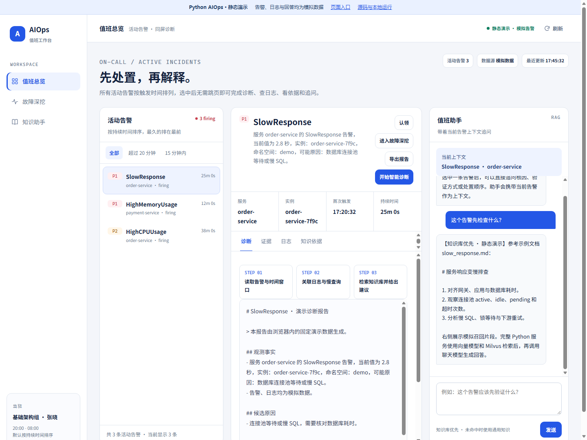
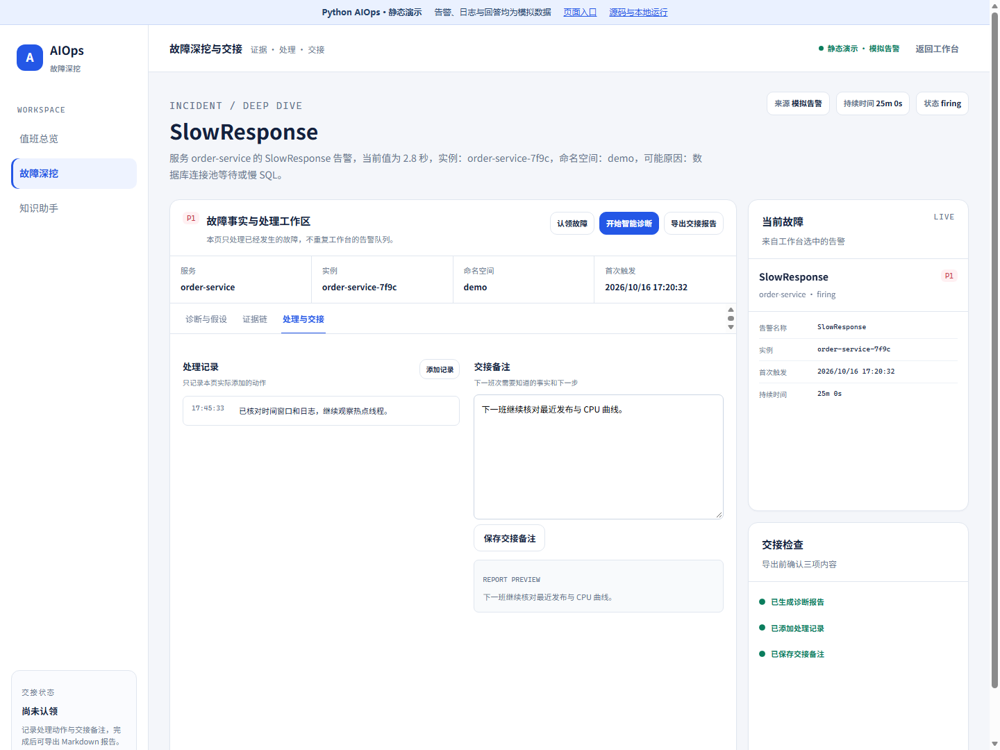
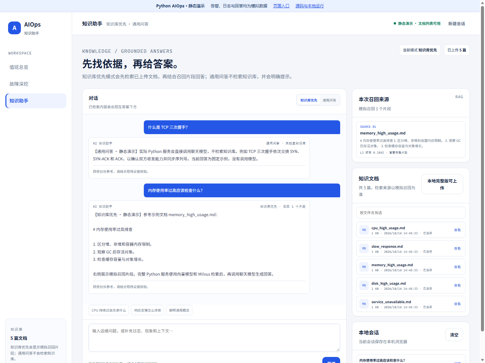
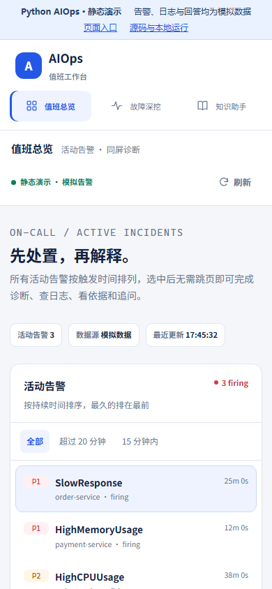
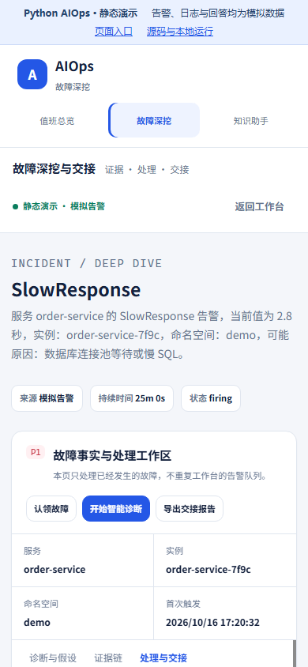
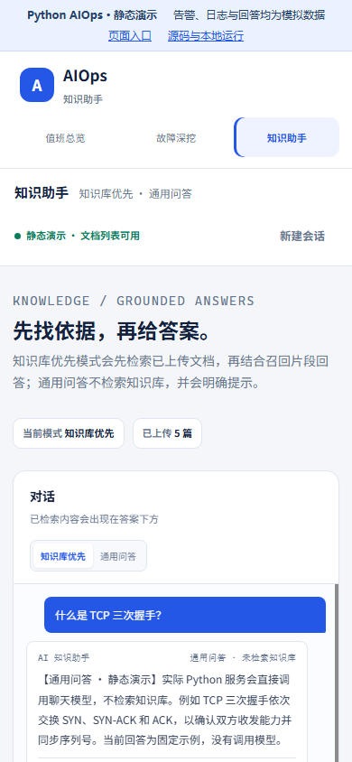

# AIOps 智能运维与知识助手平台（Python 版）

面向值班、故障排查与交接场景的 Python AIOps 工作台，把活动告警、诊断证据、处理记录和知识依据集中到同一套页面中。仓库提供可独立运行的 GitHub Pages 静态演示，以及使用 FastAPI、LangChain、LangGraph 和 Milvus 的本地完整版。

- 在线演示：[https://ifox-hu.github.io/aiops-py/](https://ifox-hu.github.io/aiops-py/)
- GitHub 仓库：[https://github.com/ifox-hu/aiops-py](https://github.com/ifox-hu/aiops-py)
- Java 参考项目：[https://github.com/ifox-hu/aiops](https://github.com/ifox-hu/aiops)
- 技术栈：Python 3.11–3.13、FastAPI、LangChain、LangGraph、Milvus、原生 HTML/CSS/JavaScript
- 前端迁移自 Java 版三页工作台，相关 Apache-2.0 许可见 [LICENSE-JAVA-UI](LICENSE-JAVA-UI)
- Pages 使用浏览器内模拟数据；本地完整版才会连接模型、Milvus 和配置的监控服务

> 项目用于值班工作台、RAG 问答和 Agent 诊断实践。诊断结果用于辅助排查，当前没有自动扩容、回滚、重启或配置变更功能。

## 1. 项目定位

项目围绕“先处置，再解释”的值班流程，把告警事实、候选原因、日志、知识库召回和交接记录组织在同一工作区中，保留两种运行形态：

1. **静态演示版**：通过 GitHub Pages 展示。浏览器中的 Mock API 提供演示告警、日志、文档和流式回答，不需要 Python 后端、数据库或模型密钥。
2. **本地完整版**：通过 FastAPI 提供 REST 与 SSE 接口，支持聊天模型、独立向量模型、Milvus、文档上传、检索增强问答和 LangGraph Plan–Execute–Replan 诊断。

## 2. 在线演示、仓库地址和核心特点

| 项目 | 地址或说明 |
| --- | --- |
| GitHub Pages 在线演示 | [打开演示首页](https://ifox-hu.github.io/aiops-py/) |
| 值班工作台 | [告警、诊断与值班追问](https://ifox-hu.github.io/aiops-py/workbench-v2.html) |
| 故障深挖与交接 | [证据、处理记录与交接备注](https://ifox-hu.github.io/aiops-py/incident-v2.html) |
| 知识助手 | [知识库优先与通用问答](https://ifox-hu.github.io/aiops-py/knowledge-v2.html) |
| GitHub 仓库 | [ifox-hu/aiops-py](https://github.com/ifox-hu/aiops-py) |
| 本地完整版默认入口 | [http://127.0.0.1:9900/](http://127.0.0.1:9900/) |

核心特点：

- **值班总览**：按优先级及持续时间展示告警，支持筛选、同屏诊断、日志、知识依据和上下文追问。
- **诊断历史**：每个告警保存最近一次报告；切换或刷新后可恢复，支持删除。
- **故障交接**：分开呈现观测事实、候选原因和待验证项，支持处理记录、交接备注与 Markdown 导出。
- **知识问答**：知识库优先和通用问答双模式，展示实际召回来源。
- **Python Agent**：保留 LangGraph 计划、执行、重规划流程和结构化步骤事件。
- **双形态部署**：Pages 用于展示，本地 Python 服务用于模型、工具及 RAG 联调。

## 3. 项目解决的问题和目标用户

| 目标用户 | 典型问题 | 项目提供的方式 |
| --- | --- | --- |
| 一线值班人员 | 告警、日志和排查结果分散 | 在值班总览集中查看与追问 |
| 故障排查与交接人员 | 事实、假设和处理进度混在一起 | 在故障页拆分证据、处理动作和交接备注 |
| 知识维护者 | 排障文档难以复用 | 上传、切片、向量化，并通过问答展示召回片段 |
| Python 与平台开发者 | 需要验证 Agent、RAG 和 SSE 链路 | 提供 FastAPI、LangChain、LangGraph 和 Milvus 实现 |
| 项目展示者 | 需要无需后端的访问入口 | 使用 GitHub Pages 静态演示 |

## 4. 主要功能

### 4.1 值班总览

- 读取活动告警，按优先级和持续时间排序，支持全部、超过 20 分钟、15 分钟内等筛选。
- 在同一页面切换诊断、证据、日志和知识依据。
- 单告警诊断通过 /api/chat_stream 携带当前告警上下文，流式展示报告。
- 诊断完成后保存该告警最近一次报告，可恢复、删除及导出。
- 值班助手携带告警上下文追问，输入支持 Enter 发送、Shift+Enter 换行，兼容中文输入法。

### 4.2 故障深挖与交接

- 展示告警服务、实例、命名空间、触发时间和持续时间。
- 分开组织观测事实、候选原因和待验证项。
- 查询关联日志、查看知识文档，承接工作台已生成的诊断报告。
- 添加处理记录、保存交接备注，并导出 Markdown 报告。

诊断历史和交接记录保存在当前浏览器，不是多人共享工单。删除诊断历史会移除报告，保留处理记录和交接备注；清理浏览器站点数据则会清空本地记录。

### 4.3 知识助手

**知识库优先模式**

- 将问题向量化，从 Milvus 检索相关片段，再调用聊天模型生成答案。
- 通过 SSE 的 sources 事件返回本次召回内容、文件元数据和距离。
- 检索失败、未命中或资料不足时允许使用通用知识补充，并要求模型注明。
- score 为 L2 距离，越小表示距离越近，不代表答案可信度或概率。

**通用问答模式**

- 直接调用聊天模型，不检索知识库。
- 不显示知识库来源，页面会标明当前回答模式。

**文档管理**

- 本地版接受 UTF-8 的 .md、.markdown 和 .txt，单文件最大 10 MB。
- 上传后自动切片、向量化并写入 Milvus，同名文件会覆盖原文件。
- 索引失败返回 HTTP 500，原文件保留；修复配置后重新上传。
- 文件出现在列表中只代表已保存，是否可检索应以召回结果为准。
- Pages 使用固定示例文档，禁用上传，不保存文件或建立向量索引。

## 5. 界面预览

以下为 Python 页面在 Pages 模拟模式下的预览。

### 值班总览

### 故障深挖与交接

### 知识助手

### 移动端预览

| 值班总览 | 故障深挖 | 知识助手 |
| --- | --- | --- |
|  |  |  |

## 6. 静态演示版与本地完整版的对比

| 能力 | GitHub Pages 静态版 | 本地 Python 完整版 |
| --- | --- | --- |
| 运行依赖 | 浏览器和静态文件服务器 | Python 3.11–3.13；RAG 另需向量模型和 Milvus |
| 页面入口 | docs/index.html 和三个工作台页面 | http://127.0.0.1:9900/ 和 /designs/*.html |
| 告警 / 日志 | 浏览器内模拟数据 | 默认模拟数据，可配置 Prometheus / CLS |
| 问答 / 诊断 | 固定示例和模拟流式输出 | 聊天模型、Agent 工具及 LangGraph |
| 知识来源 | 按关键词选择的示例片段 | 独立向量模型与 Milvus 检索 |
| 文档上传 | 禁用，接口返回 409 | 保存、切片、向量化与索引 |
| 页面历史与交接 | 当前浏览器本地保存 | 同样在当前浏览器本地保存 |
| 运维变更 | 不执行 | 当前也未实现自动重启、扩容或回滚 |

## 7. 技术架构和技术栈

### 7.1 技术栈

| 层次 | 技术与说明 |
| --- | --- |
| 运行时 | Python >=3.11,<3.14 |
| Web | FastAPI、Uvicorn、Pydantic Settings |
| 对话与工具 | LangChain、ChatOpenAI 兼容接口、本地工具、可选 MCP |
| 诊断编排 | LangGraph Plan–Execute–Replan |
| 聊天模型 | DashScope 或配置的 OpenAI 兼容服务 |
| 向量模型 | Ollama bge-m3 或 DashScope text-embedding-v4，默认 1024 维 |
| 向量库 | Milvus，biz 集合，L2 距离 |
| 前端 | 原生 HTML/CSS/JavaScript、SSE，无前端构建依赖 |
| Pages | Python 标准库构建、浏览器 Mock API、GitHub Actions |
| 验证 | Python unittest、Node.js、无头 Microsoft Edge |

依赖声明见 [pyproject.toml](pyproject.toml)，锁定依赖见 [uv.lock](uv.lock)。

### 7.2 运行链路

~~~text
文档上传 → 保存 → 切片 → 独立向量模型 → Milvus

知识库优先问答 → 问题向量化 → Milvus 检索
               → 携带参考资料调用聊天模型 → SSE 返回来源和回答

单告警工作台诊断 → /api/chat_stream → 携带告警上下文调用 Agent

原生自动诊断 → /api/aiops → LangGraph 计划 / 执行 / 重规划
             → 工具调用 → 结构化步骤事件与诊断报告
~~~

## 8. 项目目录结构

~~~text
.
├── .github/workflows/pages.yml   # GitHub Pages 构建与发布
├── .env.example                 # 公开配置模板
├── .gitignore                   # 忽略凭据、本地数据与运行产物
├── .python-version              # Python 工具链版本提示
├── aiops-docs/                  # 五篇排障示例文档
├── app/
│   ├── api/                     # REST、SSE 和文件上传
│   ├── agent/aiops/             # Planner、Executor、Replanner 与状态
│   ├── core/                    # 模型工厂、Milvus 客户端
│   ├── services/                # RAG、向量化、告警、日志与诊断
│   └── tools/                   # 时间、知识库及运维工具
├── deployment/
│   ├── build-pages.py           # 从当前 Python UI 生成 Pages
│   └── check-pages-static.cjs   # 独立演示的浏览器回归
├── docs/                        # 演示入口、模拟接口与截图；三页资源在部署时生成
├── mcp_servers/                 # 可选的 MCP 示例服务
├── static/
│   ├── designs/                # Python 完整版三页 UI 源文件
│   └── index.html              # 保留的原对话页
├── tests/                       # Python 接口与 Agent 测试
├── LICENSE-JAVA-UI              # 继承 UI 的 Apache-2.0 许可
├── pyproject.toml               # Python 依赖与开发工具配置
├── uv.lock                      # 锁定依赖
└── vector-database.yml          # Milvus、etcd、MinIO、Attu
~~~

## 9. 环境要求和前置依赖

### 9.1 静态演示版

- 现代浏览器。
- 本地预览时使用 Python 自带 HTTP 服务器即可。
- 无需安装项目依赖，也无需模型 Key、Docker 或 Milvus。

### 9.2 本地完整版

| 依赖 | 用途 |
| --- | --- |
| Python 3.11–3.13 | 运行 FastAPI 和 Agent |
| Docker Compose | 启动 Milvus、etcd、MinIO 和 Attu |
| 聊天模型 Key | 诊断与问答 |
| DashScope Embedding 或 Ollama | 独立向量服务，用于索引和检索 |
| Node.js 22+、Microsoft Edge | 仅浏览器回归需要 |

## 10. 环境变量与模型、Milvus、日志和监控配置

### 10.1 环境变量

配置来源为 [app/config.py](app/config.py)，优先级为：进程环境变量 → .env.local → .env → 代码默认值。修改后重启应用。

[.env.example](.env.example) 可复制为 .env.local，填入自己的模型凭据。该示例显式使用 DashScope 向量服务，便于首次启动；代码默认向量提供方是 Ollama。

### 10.2 聊天模型与向量服务

| 配置项 | 默认值或行为 |
| --- | --- |
| DASHSCOPE_API_KEY | 默认空，DashScope 聊天和向量服务使用此凭据 |
| DASHSCOPE_API_BASE | https://dashscope.aliyuncs.com/compatible-mode/v1 |
| DASHSCOPE_MODEL / RAG_MODEL | qwen-max；改用其他服务时同步填写其模型名 |
| RELAY_API_KEY / RELAY_BASE_URL | Relay Key 非空时优先用于聊天；地址需配置为实际提供方兼容端点 |
| STRUCTURED_OUTPUT_METHOD | auto，依次尝试 json_schema、function_calling、json_mode |
| EMBEDDING_PROVIDER | 代码默认 ollama；示例配置为 dashscope |
| OLLAMA_BASE_URL / OLLAMA_EMBEDDING_MODEL | http://127.0.0.1:11435 / bge-m3 |
| DASHSCOPE_EMBEDDING_MODEL | text-embedding-v4 |
| EMBEDDING_DIMENSIONS | 1024，必须与模型输出和现有集合一致 |

聊天中转凭据不会自动用于向量化。选择 Ollama 时，需独立运行 Ollama 并准备 bge-m3；如果使用其常见的 11434 端口，应同步修改 OLLAMA_BASE_URL。

### 10.3 Milvus 与知识库

| 配置项 | 默认值 |
| --- | --- |
| MILVUS_HOST / MILVUS_PORT | localhost / 19530 |
| MILVUS_TIMEOUT | 10000 毫秒 |
| 集合名 | biz |
| UPLOAD_PATH | ./uploads |
| RAG_TOP_K | 3 |
| CHUNK_MAX_SIZE / CHUNK_OVERLAP | 800 / 100 |

### 10.4 MCP 与真实监控

| 配置项 | 默认值 |
| --- | --- |
| PROMETHEUS_MOCK_ENABLED | True |
| PROMETHEUS_BASE_URL | http://localhost:9090 |
| CLS_MOCK_ENABLED | True |
| MCP_ENABLED | False |
| MCP_CLS_URL / MCP_MONITOR_URL | http://localhost:8003/mcp / http://localhost:8004/mcp |
| MCP_CONNECT_TIMEOUT | 10 秒 |

真实告警需关闭 PROMETHEUS_MOCK_ENABLED。真实日志需关闭 CLS_MOCK_ENABLED、开启 MCP_ENABLED，并配置可用的 CLS MCP 地址。日志工具需提供 query_logs 或 queryLogs，接受 log_topic / query / limit / region，返回包含 success / logs / total 的 JSON。

各 MCP 服务独立加载；真实接入仍需在目标环境联调。示例服务说明见 [mcp_servers/README.md](mcp_servers/README.md)。

## 11. 静态版本地预览步骤

在仓库根目录执行：

~~~bash
python deployment/build-pages.py
python -m http.server 8080 --bind 127.0.0.1 --directory docs
~~~

打开 [http://127.0.0.1:8080/](http://127.0.0.1:8080/)。构建仅使用 Python 标准库，请通过 HTTP 访问页面。

## 12. 完整版安装与启动步骤

### 12.1 克隆与安装

Windows PowerShell：

~~~powershell
git clone https://github.com/ifox-hu/aiops-py.git
cd aiops-py
python -m venv .venv
.\.venv\Scripts\python.exe -m pip install -e .
Copy-Item .env.example .env.local
notepad .env.local
~~~

Linux / macOS：

~~~bash
git clone https://github.com/ifox-hu/aiops-py.git
cd aiops-py
python3 -m venv .venv
.venv/bin/python -m pip install -e .
cp .env.example .env.local
# 用编辑器填写 .env.local
~~~

### 12.2 配置模型与数据库

填写自己的 DASHSCOPE_API_KEY；如使用兼容聊天服务或本地 Ollama，按第 10 节调整对应变量。

~~~bash
docker compose -f vector-database.yml up -d --wait
~~~

默认告警和日志为模拟数据，不需要启动 MCP。

### 12.3 启动应用

~~~powershell
# Windows
.\.venv\Scripts\python.exe -m uvicorn app.main:app --host 127.0.0.1 --port 9900
~~~

~~~bash
# Linux / macOS
.venv/bin/python -m uvicorn app.main:app --host 127.0.0.1 --port 9900
~~~

Milvus 不可用时应用仍能启动，但知识检索和索引不可用；诊断与问答需要有效的聊天模型 Key。

### 12.4 启动后访问与知识库初始化

| 入口 | 地址 |
| --- | --- |
| 默认工作台 | [http://127.0.0.1:9900/](http://127.0.0.1:9900/) |
| 故障深挖 | [incident-v2.html](http://127.0.0.1:9900/designs/incident-v2.html) |
| 知识助手 | [knowledge-v2.html](http://127.0.0.1:9900/designs/knowledge-v2.html) |
| 原对话页 | [http://127.0.0.1:9900/legacy](http://127.0.0.1:9900/legacy) |
| API 交互文档 | [http://127.0.0.1:9900/docs](http://127.0.0.1:9900/docs) |
| Milvus 检查 | [http://127.0.0.1:9900/milvus/health](http://127.0.0.1:9900/milvus/health) |

在知识助手逐个上传 aiops-docs/ 中的五篇文档；也可上传一篇：

~~~bash
curl -f -X POST http://127.0.0.1:9900/api/upload -F "file=@aiops-docs/cpu_high_usage.md"
~~~

Windows PowerShell 请使用 curl.exe。文件保存后还需索引成功，问答才能检索到内容。

## 13. 停止、日志查看和常用命令

### 13.1 停止服务与数据库

运行应用的终端按 Ctrl+C 停止 Python 服务。停止数据库容器：

~~~bash
docker compose -f vector-database.yml down
~~~

### 13.2 日志与状态

~~~powershell
# Windows：查看最新应用日志
Get-ChildItem logs/*.log | Sort-Object LastWriteTime -Descending | Select-Object -First 1 | Get-Content -Tail 50

# 数据库状态
docker compose -f vector-database.yml ps
~~~

### 13.3 开发与依赖

~~~powershell
# 安装开发依赖
.\.venv\Scripts\python.exe -m pip install -e ".[dev]"

# 运行测试
.\.venv\Scripts\python.exe -m unittest discover -s tests -v
~~~

当前使用本节与第 12 节的直接命令；旧 Makefile 和 Windows 批处理已清理。

## 14. 主要 API 或 Mock API 一览

### 14.1 Python 后端 API

| 方法 | 路径 | 说明 |
| --- | --- | --- |
| POST | /api/chat | 普通问答；请求字段 Id、Question |
| POST | /api/chat_stream | SSE 对话及工作台单告警诊断 |
| POST | /api/aiops | 原生 LangGraph 诊断，接收 session_id，返回计划、步骤和报告 |
| POST | /api/ai_ops | Java 前端兼容诊断，无需请求体，输出 content / error / done |
| POST | /api/chat/clear | 清理会话 |
| GET | /api/chat/session/{session_id} | 会话信息 |
| GET | /api/platform/alerts | 告警列表和 mock 标记 |
| GET | /api/platform/logs?topic=&query= | 日志查询 |
| GET | /api/platform/documents | 已保存文档列表 |
| GET | /api/platform/documents/content?name= | 文档内容 |
| POST | /api/platform/knowledge/stream | question / history / mode，mode 为 knowledge 或 general |
| POST | /api/upload | multipart 上传并索引 |
| POST | /api/index_directory | 批量索引指定目录 |
| GET | /health | 含 Milvus 状态的健康检查，数据库不可用返回 503 |
| GET | /milvus/health | 数据库集合检查，不可用返回 503 |

知识问答示例：

~~~bash
curl -N -X POST http://127.0.0.1:9900/api/platform/knowledge/stream \
  -H "Content-Type: application/json" \
  -d '{"question":"CPU 使用率过高先检查什么？","mode":"knowledge","history":[]}'
~~~

SSE 使用 sources / content / done / error 事件。完整请求模型见启动后的 /docs。

### 14.2 浏览器 Mock API

docs/mock-api.js 只模拟三页需要的告警、日志、文档、知识问答和诊断流，不连接真实后端。

- 文档上传返回 409，页面禁用上传按钮。
- 未实现的 /api/ 请求返回 404。
- 来源片段和距离均为演示值，不是真实向量检索结果。

### 14.3 内置知识文档

| 文档 | 场景 |
| --- | --- |
| cpu_high_usage.md | CPU 使用率过高 |
| memory_high_usage.md | 内存使用率过高 |
| disk_high_usage.md | 磁盘使用率过高 |
| slow_response.md | 服务响应变慢 |
| service_unavailable.md | 服务不可用 |

## 15. 测试与浏览器回归方式

### 15.1 Python 测试

~~~powershell
.\.venv\Scripts\python.exe -m unittest discover -s tests -v
~~~

测试替换外部模型和存储调用，覆盖接口契约、上传校验、错误处理、RAG 模式及 Agent 诊断流程。

### 15.2 静态 Pages 回归

~~~powershell
.\.venv\Scripts\python.exe deployment/build-pages.py
node deployment/check-pages-static.cjs
~~~

需要 Node.js 22+ 和 Microsoft Edge，可使用 EDGE_PATH 指定浏览器路径。脚本在 /aiops-py/ 子路径验证页面跳转、流式输出、回车发送、历史恢复和删除、交接导出、知识问答模式和移动端布局。

### 15.3 语法与预览图

~~~powershell
node --check docs/mock-api.js
node --check docs/workbench-v2.js
node --check docs/incident-v2.js
node --check docs/knowledge-v2.js
node deployment/check-pages-static.cjs --screenshots
~~~

最后一条会更新 docs/assets/previews/ 中的桌面与移动端截图。

## 16. GitHub Pages 部署方式

在线地址：[https://ifox-hu.github.io/aiops-py/](https://ifox-hu.github.io/aiops-py/)。

工作流为 [.github/workflows/pages.yml](.github/workflows/pages.yml)：

1. main 分支推送或手动触发 Deploy Python AIOps Pages。
2. 使用 Python 标准库脚本，从 static/designs/ 收集指定的页面、样式和脚本。
3. 配置 Pages，将 docs/ 上传为站点产物。
4. 部署到 github-pages 环境。

首次启用时，仓库 Settings → Pages → Source 选择 **GitHub Actions**。

修改工作台应编辑 static/designs/ 源文件；展示首页、模拟接口与演示样式分别编辑 docs/index.html、docs/mock-api.js 和 docs/demo.css。三页资源在部署时自动生成，不重复提交到仓库，避免完整版与演示版脱节。

## 17. 数据边界和已知限制

- Pages 的告警、日志、诊断和问答均为模拟数据，不运行 Python 或真实模型。
- 本地版默认模拟告警与日志；真实 Prometheus / CLS 接入需要自行配置和联调。
- 页面历史按当前浏览器保存，每个告警保留最近一次报告，尚无多人共享工单或完整历史版本库。
- 模型可能在资料不足时使用通用知识补充，召回距离不能当作答案可信度。
- Python 与 Java 默认均占用 9900 端口，同时运行时需修改其中一个。数据库使用固定容器名，共用前需核对向量模型和数据。
- .env.local、上传文件、数据库数据、日志与虚拟环境不进入 Git 仓库和 Pages。
- 本项目提供诊断建议，当前没有自动执行运维变更的能力。

## 18. 许可证和开发说明

- 前端迁移自 Java AIOps，继承 UI 的 Apache-2.0 许可见 [LICENSE-JAVA-UI](LICENSE-JAVA-UI)。
- Python 仓库尚未单独提供根目录 LICENSE，不额外声明整个仓库为 MIT 或其他许可。
- SuperBizAgent 包名和部分配置名保留用于兼容现有 Python 代码。
- 仓库已清理失效的 Python 3.10 工具配置、重复配置、未引用设计脚本和旧启动脚本，运行与开发入口以本文为准。

## 贡献与反馈

欢迎通过 [GitHub Issues](https://github.com/ifox-hu/aiops-py/issues) 提交问题或建议。修改接口、模型配置或页面后，请同步更新说明并运行对应测试；不要提交真实凭据或生产数据。
