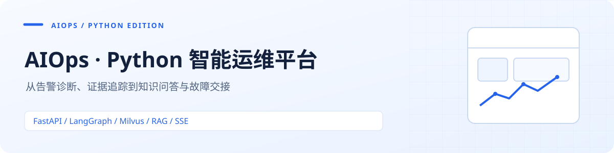
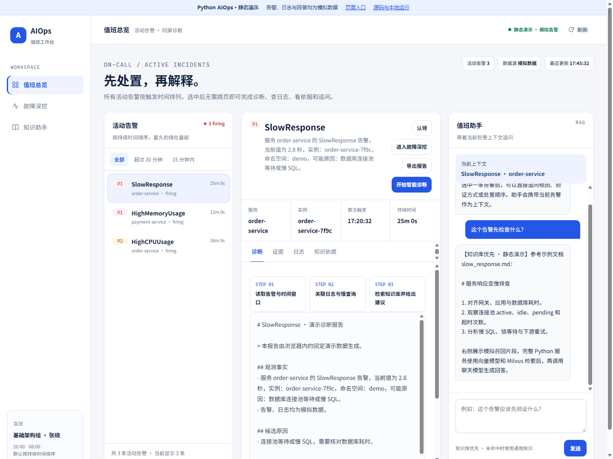
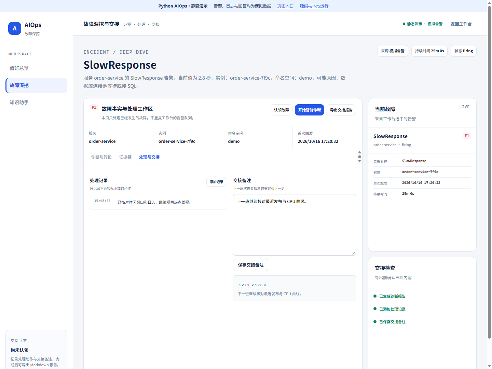
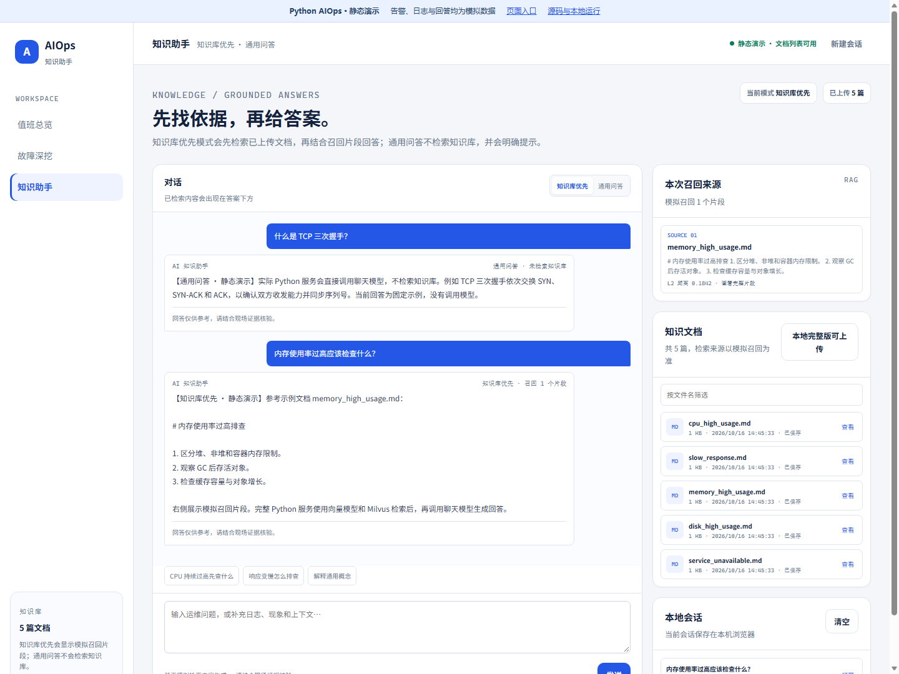
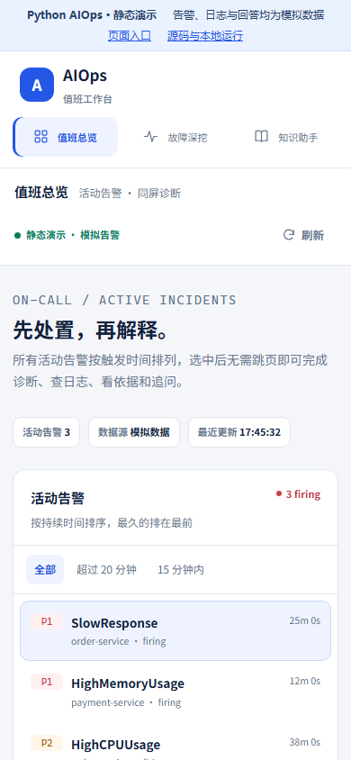
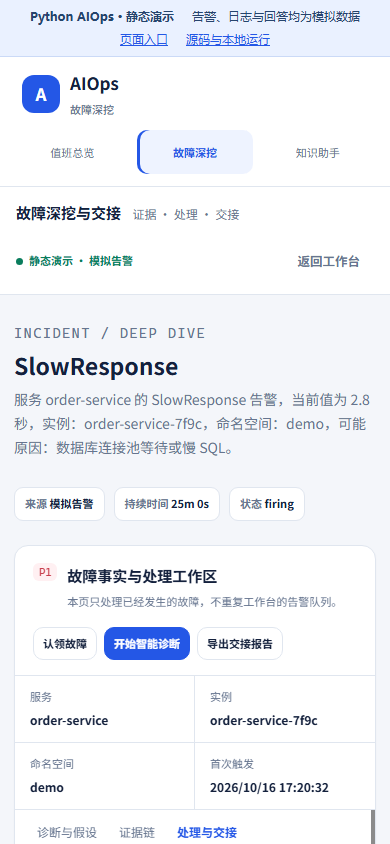
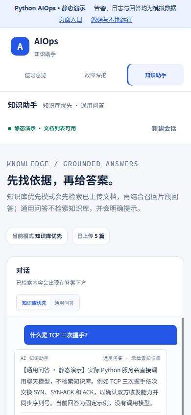
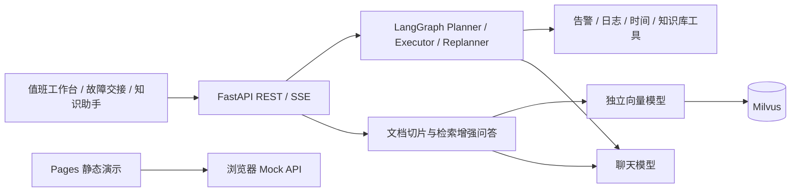

<div align="center">
  
  <h1>AIOps · Python 智能运维平台</h1>
  <p>把告警、诊断证据、处理记录与知识依据放进同一张工作台。</p>


  <p><a href="https://ifox-hu.github.io/aiops-py/">在线演示</a> · <a href="#功能模块">功能模块</a> · <a href="#界面预览">界面预览</a> · <a href="#快速开始">快速开始</a> · <a href="docs/development-guide.md">开发文档</a></p>
</div>

## 项目介绍

**AIOps · Python 智能运维平台** 面向值班人员、故障排查人员与运维知识维护者，围绕“查看告警 → 诊断取证 → 记录处理 → 故障交接 → 知识复用”组织工作流程。后端使用 **FastAPI、LangChain、LangGraph**，结合 Milvus 向量检索与 SSE 流式输出，提供告警诊断、检索增强问答和文档索引能力。

仓库提供可直接访问的 **GitHub Pages 静态演示**，以及连接模型、向量库和监控工具的 **本地完整版**。前端沿用 [Java 版](https://github.com/ifox-hu/aiops)的三页工作台，后端采用 Python 的 Plan–Execute–Replan 诊断流程。

> 项目定位：个人学习与工程实践展示。Pages 使用浏览器模拟数据；本地版是否连接真实监控由配置决定。当前提供诊断建议，不自动执行扩容、回滚、重启或配置变更。

## 在线演示

| 体验方式 | 入口 | 说明 |
| --- | --- | --- |
| **Pages 静态演示** | [打开演示首页](https://ifox-hu.github.io/aiops-py/) | 无需登录、模型 Key 或数据库；接口与诊断内容为模拟数据 |
| **值班工作台** | [告警与诊断](https://ifox-hu.github.io/aiops-py/workbench-v2.html) | 告警筛选、流式诊断、证据与上下文追问 |
| **故障深挖** | [排查与交接](https://ifox-hu.github.io/aiops-py/incident-v2.html) | 事实、候选原因、处理记录与 Markdown 导出 |
| **知识助手** | [知识问答](https://ifox-hu.github.io/aiops-py/knowledge-v2.html) | 知识库优先与通用问答双模式 |
| **本地完整版** | 部署后访问 `http://127.0.0.1:9900/` | 需配置模型、向量服务和 Milvus |

**推荐体验路线**：进入值班工作台 → 选择告警 → 运行诊断 → 查看日志和知识依据 → 进入故障深挖 → 添加处理记录与交接备注 → 导出报告 → 打开知识助手切换问答模式。

## 功能模块

| 模块 | 已有能力 | 对应源码 |
| --- | --- | --- |
| **值班工作台** | 活动告警、持续时间筛选、诊断流、日志与知识依据、告警上下文追问 | [工作台页面](static/designs/workbench-v2.html) |
| **故障深挖与交接** | 观测事实、候选原因、待验证项、处理记录、交接备注与报告导出 | [故障页面](static/designs/incident-v2.html) |
| **知识助手** | 知识库优先 / 通用问答、来源片段、流式输出与浏览器会话 | [知识页面](static/designs/knowledge-v2.html) |
| **文档与 RAG** | 本地上传、Markdown 切片、向量化、Milvus 索引与检索 | [服务实现](app/services) |
| **Agent 诊断** | LangGraph 计划、执行与重规划，结构化步骤事件 | [诊断实现](app/agent/aiops) |
| **监控与工具** | 默认模拟告警和日志，可选 Prometheus / CLS MCP 接入 | [工具实现](app/tools) |

页面交接记录保存在当前浏览器，并非多人共享工单。向量检索返回的 L2 距离用于描述检索距离，不代表答案可信度。上传、索引及两种运行形态的区别见[完整说明](docs/development-guide.md)。

## 界面预览

以下为 Python 版 Pages 模拟模式截图。

| 值班工作台 | 故障深挖与交接 |
| --- | --- |
|  |  |

| 知识助手 |
| --- |
|  |

### 移动端

| 值班工作台 | 故障深挖 | 知识助手 |
| --- | --- | --- |
|  |  |  |

## 技术架构



| 层次 | 技术 |
| --- | --- |
| 后端 | Python 3.11–3.13、FastAPI、LangChain、LangGraph |
| 知识检索 | Milvus、Ollama / DashScope Embedding、Markdown 切片 |
| 前端 | 原生 HTML / CSS / JavaScript、SSE，无前端构建依赖 |
| 本地部署 | Docker Compose、Python 虚拟环境 / Uvicorn |
| 演示与验证 | GitHub Pages、Node.js、无头 Edge、Python unittest |

## 快速开始

### 只预览静态演示

在线演示无需安装依赖。本地预览在克隆仓库后执行：

```bash
python deployment/build-pages.py
python -m http.server 8080 --bind 127.0.0.1 --directory docs
```

访问 `http://127.0.0.1:8080/`。构建只依赖 Python 标准库，不需要安装后端依赖。

### 启动本地完整版

```powershell
git clone https://github.com/ifox-hu/aiops-py.git
cd aiops-py
python -m venv .venv
.\.venv\Scripts\python.exe -m pip install -e .
Copy-Item .env.example .env.local
# 编辑 .env.local，填写自己的模型凭据与向量服务配置
docker compose -f vector-database.yml up -d --wait
.\.venv\Scripts\python.exe -m uvicorn app.main:app --host 127.0.0.1 --port 9900
```

Python 解释器需为 3.11–3.13。示例配置使用 DashScope 向量服务；聊天模型与向量模型凭据分别配置。Linux / macOS 安装与启动命令见[开发文档](docs/development-guide.md#完整版安装与启动步骤)。

启动后访问 `http://127.0.0.1:9900/`。首次使用知识库时，在知识助手上传 [aiops-docs/](aiops-docs/) 中的示例文档，确认索引成功后再提问。

## 项目结构

```text
aiops-py/
├── app/                       FastAPI 接口、Agent、RAG 与工具
├── static/                    本地完整版工作台源文件
├── aiops-docs/                排障示例知识文档
├── deployment/                Pages 构建与浏览器回归
├── docs/                      Pages 演示、开发文档与当前截图
├── mcp_servers/               可选 MCP 示例服务
├── tests/                     Python 接口与 Agent 测试
├── pyproject.toml             依赖声明
├── uv.lock                    锁定依赖
└── vector-database.yml        Milvus 配套服务
```

## 项目文档

| 文档 | 内容 |
| --- | --- |
| [开发、部署与验证](docs/development-guide.md) | 环境要求、模型与数据库配置、启动、API、测试、Pages 发布及已知边界 |
| [内置排障文档](aiops-docs/) | CPU、内存、磁盘、响应变慢和服务不可用示例 |
| [MCP 示例说明](mcp_servers/README.md) | 可选日志与监控工具服务 |
| [Java 参考项目](https://github.com/ifox-hu/aiops) | 三页工作台来源与 Java 后端实现 |

## 来源与说明

前端迁移自 Java AIOps，继承 UI 的 Apache-2.0 许可见 [LICENSE-JAVA-UI](LICENSE-JAVA-UI)。Python 仓库尚未单独提供根目录 LICENSE，不将整个仓库额外声明为其他许可证。

请勿提交真实模型凭据、生产日志、上传文档或数据库数据。反馈与改进建议可提交到 [Issues](https://github.com/ifox-hu/aiops-py/issues)。

<div align="center"><a href="#项目介绍">返回顶部 ↑</a></div>
